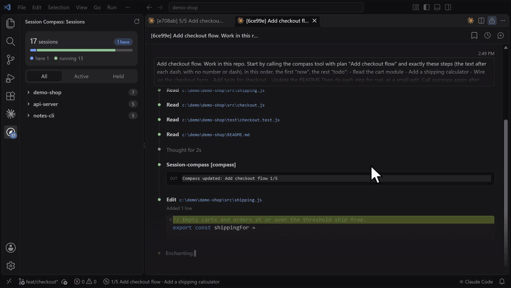
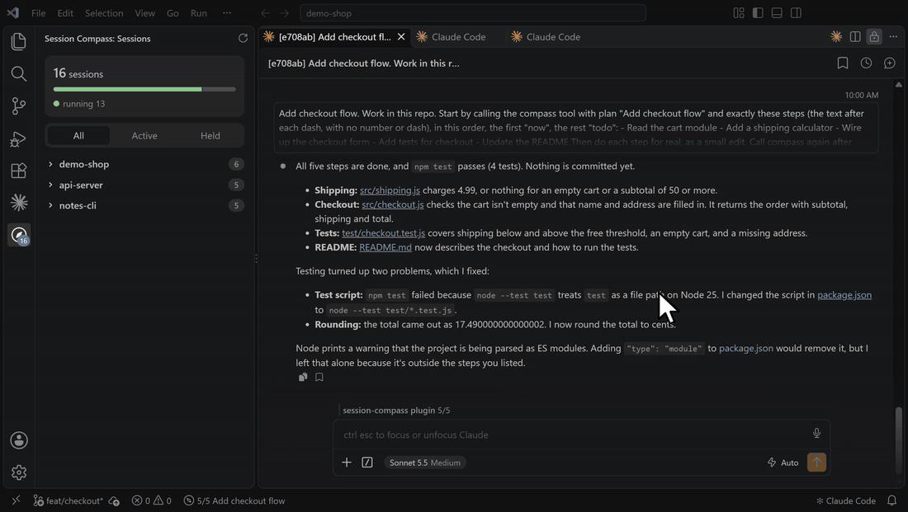
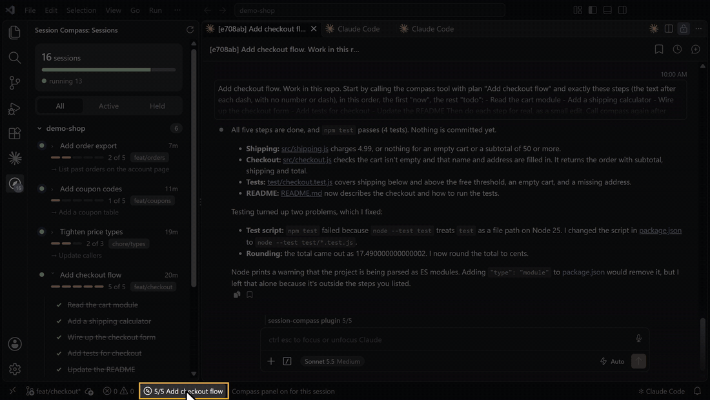

<div align="center">

# 🧭 Session Compass

<br>

### Six Claude Code sessions open.

🔧 **One is mid-refactor.**<br>
⏳ **One is waiting on you.**<br>
✅ **One finished twenty minutes ago.**

<br>

# Which is which?

<br>

Session Compass tells you at a glance:

### the repo · the branch · the plan · the step

<sub>each session is on</sub>

<br>

</div>

---


## Watch a plan run

Claude writes a plan and ticks each step off. You see it without opening anything.



## Find any session

Every live session in one sidebar, grouped by repo. Open one for its steps.



## Stay in the chat

Don't want the sidebar? The plan opens beside the conversation, and /sessions lists everything.



## Install

Compass is two parts. The **mod** (a Claude Code plugin, in `mod/`) gives Claude a `compass` tool, sets the tab title, shows a status line, toasts each finished step, and adds `/sessions` and `/compass`. The **VS Code extension** (in `extension/`) adds the sidebar and the status bar item. The mod works without the extension; the extension shows nothing without the mod.

Mod (in your terminal):

```
claude plugin marketplace add m4cd4r4/session-compass
claude plugin install session-compass@session-compass
```

Extension: search "Session Compass" in VS Code, or

```
code --install-extension macdara.session-compass
```

It is also on [Open VSX](https://open-vsx.org/extension/macdara/session-compass) for VSCodium and Cursor.

<details>
<summary>How it works, in detail</summary>

## How it works

1. The mod tells Claude to call `compass` when a task has 3 or more steps, when a step starts or finishes, and when the plan changes. A call carries a 3 to 6 word plan name and the whole step list, each step marked `done`, `now` or `todo`.
2. Each call updates the tab title, the status line, and one JSON file per session in `~/.claude/session-compass/` (or `$CLAUDE_CONFIG_DIR/session-compass/`).
3. The extension watches that folder and shows each session as a card in the Sessions view. A finished session, or one with no plan steps yet, that goes quiet for 6 hours is marked idle and dropped after 24 hours. One with plan steps left that goes quiet for 6 hours shows as paused (amber, "paused 3d") and stays for 7 days. Hover a card and click x to hide it; it comes back if the session updates (hidden entries live in `~/.claude/session-compass/dismissed.json`). Ended sessions, and sessions that never got a message or a plan, are hidden.

`/sessions` lists every live session in the terminal. `/compass` prints the plan, stage, done, now and todo of the current one.

### Parent plans

If a worktree registry exists (`workspaces/registry.json` in the same Claude folder, or the `sessionCompass.registryPath` setting), the sidebar shows each parent plan above the sessions of its repo: entries that share a `plan`, ordered by `wave`. A plan shows while it has two or more slices, at least one still open, and one touched in the last 14 days or with a worktree on disk. A repo with a plan but no live session gets a group of its own, so the plan stays reachable.

Each open slice is one of: working (worktree on disk), blocked, due (its `gate_date` has passed), held (a `gate_reason` with no date or a date ahead, or a `depends_on` slug still open), or ready. Done slices are counted in the plan's summary, not listed. Open a slice and press **Copy resume** to copy its resume action: the worktree path for a working slice, else `sessionCompass.resumeCommand` with `{slug}` filled in. A working slice also has **Open worktree**, which opens its folder in a new window. The extension only reads the registry; it never writes it.

### Restart note

If `restart-note.md` exists in the same folder, a freshly started session (not one continued by `/clear` or a compact) is told its contents and mentions it in the first reply. The sidebar shows it at the top.

## Themes

The sidebar uses your VS Code theme colours, so it follows dark, light and high contrast. Shown with sample data.

| Dark | Light | High contrast |
|---|---|---|
|  |  |  |

</details>

## What it reads and sends

Reads and writes only the folder above, plus `git` in the session's directory to find the repo and branch. Neither part makes a network request.

## Develop

```
cd extension && npm install && npm test && npm run package
```

## Licence

MIT, see [extension/LICENSE](extension/LICENSE).
